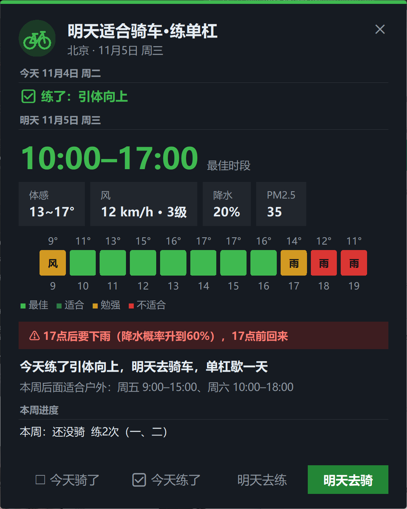

# ride-weather 🚲

一个 [Claude Code](https://claude.com/claude-code) skill：**每周骑一次车**。

- 每晚 20:30 弹一张卡片：**今天做了什么 / 明天适不适合骑车、练单杠 / 本周进度**
- 卡片上点「今天骑了」「今天练了」记一笔；选「明天去骑 / 明天去练」记下计划，第二天晚上核对，漏记的能补
- 可选读取[训记](https://www.xunjiapp.cn) App 的训练记录（装了 xunji skill 才读）
- 跟 Claude 说「今天骑车了」也能记；问「这周哪天能骑」，看未来 7 天每天的最佳时段



提醒是一张右上角的小卡片：最佳时段、体感/风/降水/PM2.5，逐小时天气条（深绿=最佳时段，绿=适合，黄=勉强：小雨/风大/轻度污染，红=不适合：大雨/冷/热/大风/重污染），跟随系统深浅色；比屏幕高时自动缩小。

```
西安  本周还没骑
10-31 周六(明天)  ✅ 10:00–14:00  体感11~13° 风6km/h   [体感9~13° 降水概率最高78% 风13km/h PM2.5最高91]
11-01 周日(后天)  ✅ 13:00–18:00  体感11~12° 风8km/h   [体感10~12° 降水概率最高43% 风9km/h PM2.5最高64]
11-03 周二  ❌ 雨   [体感10~11° 降水概率最高42% 风7km/h PM2.5最高69]
```

天气数据来自 [Open-Meteo](https://open-meteo.com)（免费、免 key），只用 Python 标准库，不用装任何依赖。

## 判断标准

在可骑时段（默认周末 9–18 点、工作日 17–19 点；设 `day_hours: [9, 20]` 则每天都看 9–20 点）里，要有**连续 ≥3 小时**同时满足（都满足=绿；超过下表但没到红线=黄；到红线=红：雨量 >1mm/h 或概率 ≥70%、风 >35 / 阵风 >55km/h、PM2.5 >115、冷热超限）：

| 项 | 默认阈值 | 配置键 |
|---|---|---|
| 降水 | 概率 ≤30%，雨量 ≤0.2mm/h | `rain_prob_max` `rain_mm_max` |
| 体感温度 | 5–33°C | `feel_min` `feel_max` |
| 风 | ≤25km/h，阵风 ≤40km/h | `wind_max` `gust_max` |
| PM2.5 | ≤75 μg/m³ | `pm25_max` |
| 路面 | 出发前 12 小时雨量 ≤5mm | `wet_road_mm` |
| 连续时长 | ≥3 小时 | `min_block` |

## 安装

需要 Python 3.8+。

```bash
# 1. 放进 Claude Code 的 skills 目录
git clone https://github.com/jasonkyo/ride-weather ~/.claude/skills/ride-weather

# 2. 设置城市（中文英文都行）
python ~/.claude/skills/ride-weather/scripts/ride_check.py setup 西安

# 3. 看看效果
python ~/.claude/skills/ride-weather/scripts/ride_check.py week
```

### 每晚自动提醒

**Windows**（每天 20:30，`pythonw` 不会弹黑框）：

```powershell
schtasks /create /tn RideWeather /sc daily /st 20:30 /f /tr "\"<pythonw.exe 路径>\" \"%USERPROFILE%\.claude\skills\ride-weather\scripts\ride_check.py\" notify"
```

**macOS / Linux**（`crontab -e` 加一行）：

```
30 20 * * * /usr/bin/env python3 ~/.claude/skills/ride-weather/scripts/ride_check.py notify
```

卡片用 Python 自带的 tkinter 画（不走系统通知，Windows 11 上 PowerShell toast 经常被静默丢弃）。没有 tkinter 时退回系统弹窗：Windows MessageBox、macOS `osascript`、Linux `notify-send`。

## 自定义

在 `~/.ride-weather/config.json` 里只写要改的键，例如：

```json
{
  "weekday_hours": [15, 18],
  "feel_min": 8,
  "wind_max": 20
}
```

数据目录可以用环境变量 `RIDE_WEATHER_HOME` 改到别处。

## 命令

```
ride_check.py setup <城市>        设置城市
ride_check.py week              未来 7 天能不能骑
ride_check.py log [日期] [备注]  记一次骑行
ride_check.py train [日期] [内容] 补记一次训练
ride_check.py plan [日期] [ride|train]  记下明天去骑/去练
ride_check.py status            本周骑了没、连续达标周数
ride_check.py notify            定时任务用
ride_check.py notify --preview  弹一下卡片看效果
ride_check.py skip              这周不骑了
```

装好之后直接跟 Claude 说话就行：「今天骑车了，30 公里」「这周哪天能骑」「风的标准放宽点」。

## License

MIT
